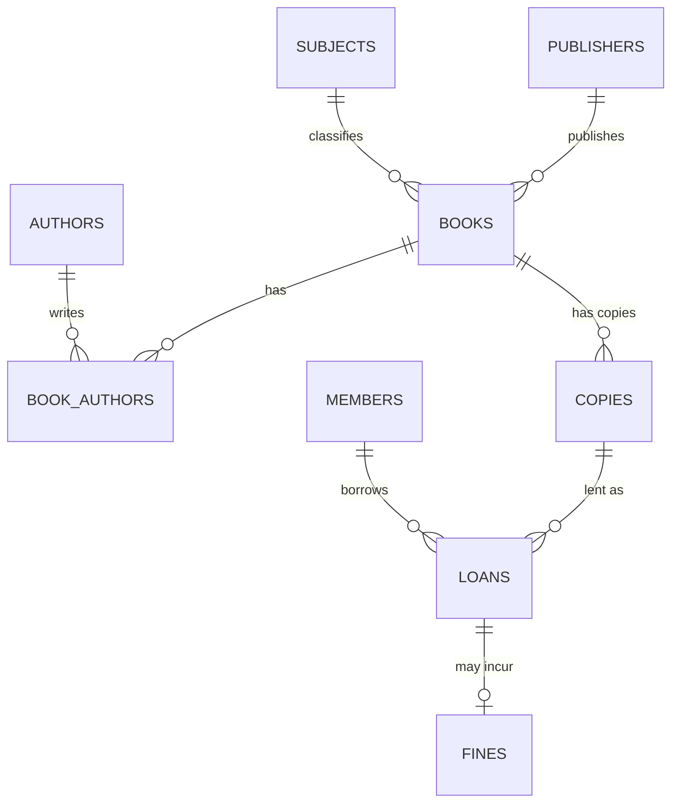

# LibraNet - Library Circulation and Reader Analytics

GUVI x HCL, Problem 07. Tech stack, as in the problem statement:

- **SQL: MySQL 8** for the relational database (DDL, DML, analytical queries, fine trigger)
- **Python DB-API** (`mysql-connector-python`) for circulation operations and analysis, with matplotlib charts
- **MongoDB** (`pymongo`) for e-resource access logs: CRUD, indexes, aggregation

| Requirement | Where it is |
|---|---|
| Schema design and normalisation | `sql/01_schema.sql` (3NF, many-to-many `book_authors`) |
| SQL DDL and DML | DDL: `sql/01_schema.sql`. DML: `sql/03_dml.sql` (issue, renew, return, fine payment) |
| Analytical SQL queries | `sql/04_queries.sql` (most borrowed, overdue members, fines collected, borrowing by subject and month) |
| Trigger to calculate fines on return | `sql/02_triggers.sql` (`trg_loans_on_return`) |
| Python DB-API analysis and charts | `python/analysis.py`, `python/library_ops.py` |
| MongoDB model, CRUD, indexes | `mongo/mongo_seed.py`, `mongo/mongo_crud.py`, `mongo/common.py` |
| MongoDB aggregation and insights | `mongo/mongo_aggregations.py` |

## 1. Prerequisites

| Needed for | Requirement |
|---|---|
| Everything | Python 3.9 or newer with `pip` |
| SQL part | **MySQL Server 8.0.16 or newer** (CHECK constraints are only enforced from 8.0.16), with a user that can create databases and triggers (`root` is simplest) |
| Python packages | `mysql-connector-python`, `matplotlib`, `pymongo` (all in `requirements.txt`) |
| MongoDB part | MongoDB 6.0 or newer (Community Edition, Docker, or a free Atlas cluster) |
| Optional | MySQL Workbench or DBeaver to browse the database. MongoDB Compass or `mongosh` to browse MongoDB |

## 2. Steps to run

```bash
# 1. unzip and enter the folder
unzip libranet.zip
cd libranet

# 2. (recommended) create a virtual environment
python -m venv .venv
source .venv/bin/activate          # Windows: .venv\Scripts\activate

# 3. install Python packages
pip install -r requirements.txt

# 4. start MySQL and MongoDB - pick what you have installed
#    MySQL, option a) Docker:
docker run -d --name libranet-mysql -e MYSQL_ROOT_PASSWORD=root -p 3306:3306 mysql:8
#    MySQL, option b) your local MySQL Server / XAMPP / WAMP (make sure the service is running)
#    MongoDB, option a) Docker:
docker run -d --name libranet-mongo -p 27017:27017 mongo:7
#    MongoDB, option b) local service, or option c) Atlas: export MONGO_URI="mongodb+srv://..."

# 5. tell the scripts how to log in to MySQL (use YOUR password)
export MYSQL_USER=root
export MYSQL_PASSWORD=root
#    Windows PowerShell:  $env:MYSQL_USER="root"; $env:MYSQL_PASSWORD="root"
#    Windows cmd:         set MYSQL_PASSWORD=root

# 6. run everything
python run_all.py
```

On Windows use `python` or `py` instead of `python3`. To run only the MySQL and Python parts:
`python run_all.py --skip-mongo`. If MongoDB is unreachable, `run_all.py` skips its steps
and says so. MySQL is required.

**Warning:** `python/setup_db.py` drops and re-creates the database named in `MYSQL_DATABASE`
(default `libranet`). Do not point it at a database you want to keep.

| Variable | Default |
|---|---|
| `MYSQL_HOST` | `127.0.0.1` |
| `MYSQL_PORT` | `3306` |
| `MYSQL_USER` | `root` |
| `MYSQL_PASSWORD` | empty |
| `MYSQL_DATABASE` | `libranet` |
| `MONGO_URI` | `mongodb://localhost:27017` |

### Run the steps individually

```bash
python python/setup_db.py            # create database libranet (schema, triggers, sample data)
python python/run_dml_demo.py        # issue, renew, return (fine trigger), pay fine
python python/analysis.py            # analytical queries + charts in ./output
python mongo/mongo_seed.py           # create access_logs, load events, build indexes
python mongo/mongo_crud.py           # create / read / update / delete + index plan
python mongo/mongo_aggregations.py   # top e-resources, engagement by department
python -m unittest discover -s tests -v   # offline splitter tests + 9 database tests
```

`run_dml_demo.py` can run only once per database. To run it again, rebuild first with
`python python/setup_db.py`.

### Running the SQL files directly (MySQL Workbench or the mysql client)

```bash
mysql -u root -p -e "CREATE DATABASE libranet"
mysql -u root -p libranet < sql/01_schema.sql
mysql -u root -p libranet < sql/02_triggers.sql      # contains DELIMITER lines, fine in the client
mysql -u root -p libranet < sql/03_dml.sql           # needs sample data first (run setup_db.py)
```

### What you get

- MySQL database `libranet`: 26 books, about 74 copies, 60 members, about 360 loans, with fines created by the trigger
- `output/analysis_report.txt`: every query result
- `output/*.png`: demand by subject, monthly circulation, top titles, subject-by-month heatmap, fines collected
- `output/mongo_insights.json` and `output/mongo_engagement_by_department.png` (after the MongoDB steps)

The sample data is synthetic. It is generated from a fixed seed relative to today's date,
so there are always some overdue loans to report.

## 3. Design

### Relational schema (3NF)



- Book facts (title, ISBN) live in `books`. Physical items live in `copies`, so a title is not repeated for each copy.
- Publisher and subject are separate tables, so their names are stored once.
- `book_authors` resolves the many-to-many relationship between books and authors, with an author order.
- Fines are a separate table, one row per late loan (`loan_id` is UNIQUE).
- Constraints: primary and foreign keys, `UNIQUE` (ISBN, barcode, email), `ENUM` for status values, `CHECK` (renewals 0 to 2, dates in order, pub_year range, amounts), and a unique index on the generated column `open_copy_id` so a copy can have only one open loan (MySQL has no partial indexes).
- Fine rates live in a `settings` table (`fine_per_day` 2.00, `fine_cap` 500.00), so the rule can change without editing the trigger.

### Triggers

| Trigger | Does |
|---|---|
| `trg_loans_before_insert` | Rejects issuing a copy that is not available, or issuing to a member who is not active (`SIGNAL SQLSTATE '45000'`) |
| `trg_loans_after_insert` | Marks the copy `on_loan` |
| `trg_loans_on_return` | When `return_date` is set: marks the copy `available` and inserts a fine of `LEAST(days_late x rate, cap)` if the book is late |

Python never calculates a fine. The database does, so every client gets the same rule.

MySQL does not allow a statement to read a table that a trigger it fires then modifies, so
`sql/03_dml.sql` looks up ids into session variables first.

### Python DB-API

`python/library_ops.py` has `issue_book`, `return_book`, `renew_loan` and `pay_fine` using
parameterised `mysql.connector` calls with transactions. `python/analysis.py` runs the
queries from `sql/04_queries.sql` through DB-API cursors and plots the results with matplotlib.
`python/db.py` also contains a small runner that understands the `DELIMITER` command, so the
same `.sql` files work in the Python scripts and in the mysql client.

### MongoDB model

Collection `libranet.access_logs`, one document per reader event:

```json
{
  "resource_id": "ER003", "resource_title": "Python for Data Analysis (e-book)",
  "resource_type": "ebook", "subject": "Computer Science",
  "member_id": 17, "department": "Computer Science",
  "action": "view", "timestamp": "2026-10-02T09:14:00Z",
  "session_minutes": 25, "device": "mobile"
}
```

Events are stored flat, one document per event, because logs are append-heavy. The member
department is copied into each event so department analysis needs no join (a deliberate
denormalisation). `member_id` matches `members.member_id` in MySQL.

Indexes: `(resource_id, timestamp desc)`, `(department, action)`, `(member_id)`, `(timestamp desc)`.

Aggregation pipelines:
1. Top 10 e-resources: `$group` with `$cond` for views and downloads, `$addToSet` and `$size` for unique readers, weighted engagement score (download counts 3x).
2. Reader engagement by department: events, downloads, unique readers, events per reader, average session minutes.
3. Monthly activity trend using `$dateToString`.

## 4. Troubleshooting

| Problem | Fix |
|---|---|
| `Cannot connect to MySQL` or `Access denied` | Start MySQL and set `MYSQL_USER` / `MYSQL_PASSWORD` (step 5) |
| `Unknown database 'libranet'` | Run `python python/setup_db.py` first |
| `Authentication plugin ... is not supported` | Upgrade the driver: `pip install -U mysql-connector-python` |
| `You do not have the SUPER privilege and binary logging is enabled` when creating triggers | Use the `root` user, or run `SET GLOBAL log_bin_trust_function_creators = 1;` as root |
| `Cannot reach MongoDB` | Start MongoDB (step 4) or set `MONGO_URI` |
| `ModuleNotFoundError` | Run `pip install -r requirements.txt` in the active environment |
| `Demo already ran on this database` | Run `python python/setup_db.py`, then the demo again |
| Charts do not appear | They are saved as PNG files in `./output`, not shown in a window |
